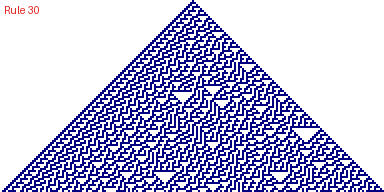

# Cellular automaton

Draws an elementary cellular automaton. A line of cells runs across the screen, and each row below is the next generation. A cell’s new state depends on itself and its two neighbours, following one of Wolfram’s 256 rules. The default, Rule 30, grows a chaotic triangle from a single live cell.

*Screenshot source: desktop stand-in (`tools/casioplot.py`). Text and colours may differ slightly on the calculator.*

## Running it

* **Calculator:** copy `cellular_automaton.py` to the calculator (see [docs/transfer.md](../../docs/transfer.md)) and run it from the Python app.
* **Desktop:** from the repository root, run `PYTHONPATH=tools python programs/cellular_automaton/cellular_automaton.py`. Add `CASIOPLOT_WAIT=1` to keep the window open, or `CASIOPLOT_SAVE=automaton.png` to save the result.

## Controls

None. The picture draws once. To change it, edit the settings at the top of the file.

## Settings

| Constant | Default | Effect |
|---|---|---|
| `RULE` | `30` | Wolfram rule number, 0 to 255 |
| `CELL_SIZE` | `2` | Width and height of each cell in pixels |
| `RANDOM_START` | `False` | Start from a random row instead of one live cell in the middle |
| `DENSITY` | `0.5` | Chance a cell starts alive when `RANDOM_START` is `True` |
| `WRAP` | `True` | Join the left and right edges into a loop. When `False`, cells beyond the edges count as dead. |
| `ROWS_PER_REFRESH` | `4` | How often the screen is redrawn while drawing |
| `SHOW_TITLE` | `True` | Write the rule number in the corner when finished |
| `ALIVE`, `TITLE` | dark blue, red | Colours of live cells and of the title |
| `SCREEN_WIDTH`, `SCREEN_HEIGHT` | `384`, `192` | `casioplot` drawing area |

Rules worth trying:

* **30:** chaotic, from one cell
* **90:** Sierpiński triangle, from one cell
* **110:** complex moving structures; try it with `RANDOM_START = True`
* **184:** traffic flow; try it with `RANDOM_START = True`

## How the rule works

The three cells above a new cell (left, centre, right) form a 3-bit number from 0 to 7. Write the rule number in binary: bit *n* gives the new cell’s state for pattern *n*. For Rule 30 (binary 00011110), patterns 1, 2, 3 and 4 give a live cell and the rest give a dead one.

## Details

| | |
|---|---|
| Lines | 93 of 300 |
| Modules | `casioplot`, `random` |
| Run time | Not yet measured on the calculator |

## Memory notes

The program keeps only two generations in memory at once: the current row and the next one. With the default `CELL_SIZE = 2` each row is a list of 192 integers. With `CELL_SIZE = 1` it is 384. The picture itself is not stored. Heap use has not been measured on the calculator.

## Tested on

* [ ] fx-CG100 calculator (OS version: )
* [ ] Casio emulator
* [x] Desktop stand-in (`tools/casioplot.py`)

## Licence

MIT. Original work, not derived from a Casio sample program.
