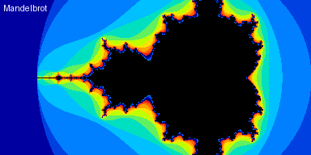

# Mandelbrot

Draws the Mandelbrot set across the whole `casioplot` screen, one column at a time. Each point is coloured by how many steps it takes to escape. Points inside the set are black.

*Screenshot source: desktop stand-in (`tools/casioplot.py`). Text and colours may differ slightly on the calculator.*

## Running it

* **Calculator:** copy `mandelbrot.py` to the calculator (see [docs/transfer.md](../../docs/transfer.md)) and run it from the Python app.
* **Desktop:** from the repository root, run `PYTHONPATH=tools python programs/mandelbrot/mandelbrot.py`. Add `CASIOPLOT_WAIT=1` to keep the window open, or `CASIOPLOT_SAVE=mandelbrot.png` to save the result.

## Controls

None. The picture draws once. To change it, edit the settings at the top of the file.

## Settings

| Constant | Default | Effect |
|---|---|---|
| `X_MIN`, `X_MAX` | `-2.4`, `1.0` | Left and right edges (real axis) |
| `Y_MIN`, `Y_MAX` | `-0.85`, `0.85` | Bottom and top edges (imaginary axis) |
| `MAX_ITER` | `16` | Steps per point. Higher shows more detail but is slower. |
| `COLUMNS_PER_REFRESH` | `8` | How often the screen is redrawn while drawing |
| `SHOW_TITLE` | `True` | Write “Mandelbrot” in the corner when finished |
| `SCREEN_WIDTH`, `SCREEN_HEIGHT` | `384`, `192` | `casioplot` drawing area |

Keep the width of the region about twice its height, so the picture is not stretched. For example, to zoom in on the “seahorse valley”, try `X_MIN = -0.85`, `X_MAX = -0.65`, `Y_MIN = 0.05`, `Y_MAX = 0.15` and `MAX_ITER = 40`.

## Details

| | |
|---|---|
| Lines | 88 of 300 |
| Modules | `casioplot` |
| Arithmetic | Floats, no `complex` type |
| Run time | Not yet measured on the calculator |

## Memory notes

The program stores no per-pixel data. It works out each pixel and draws it straight away, so memory use is a handful of floats plus the 12-colour palette. Heap use has not been measured on the calculator.

Run time grows with `MAX_ITER` and with how much of the region lies inside the set, because inside points always run the full `MAX_ITER` steps.

## Tested on

* [ ] fx-CG100 calculator (OS version: )
* [ ] Casio emulator
* [x] Desktop stand-in (`tools/casioplot.py`)

## Licence

MIT. Original work, not derived from a Casio sample program.
